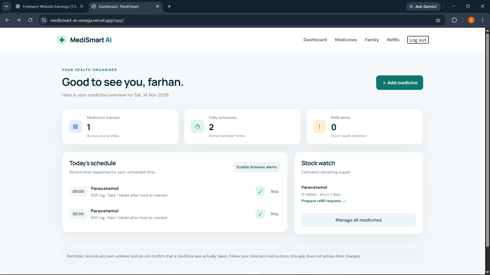
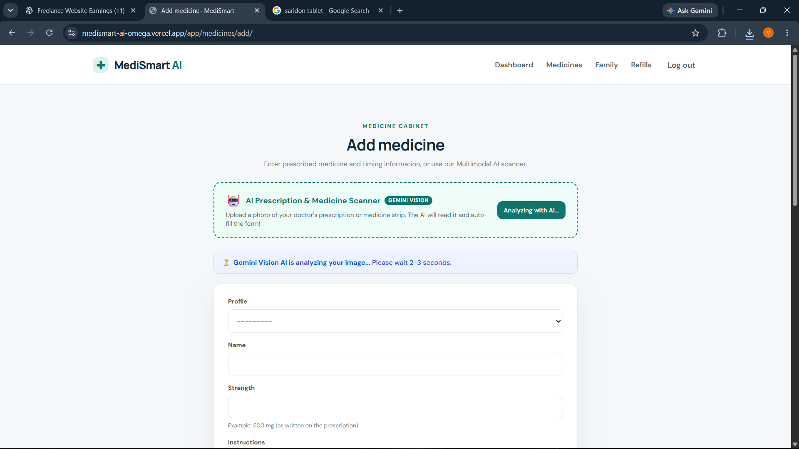
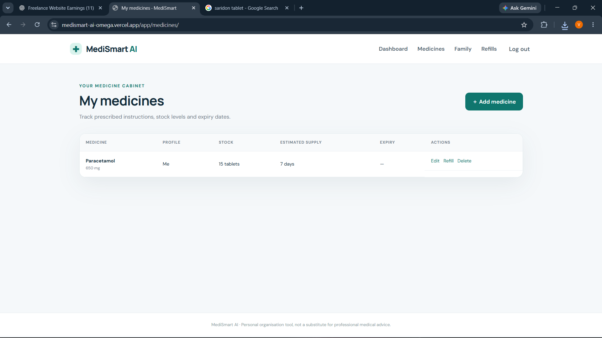
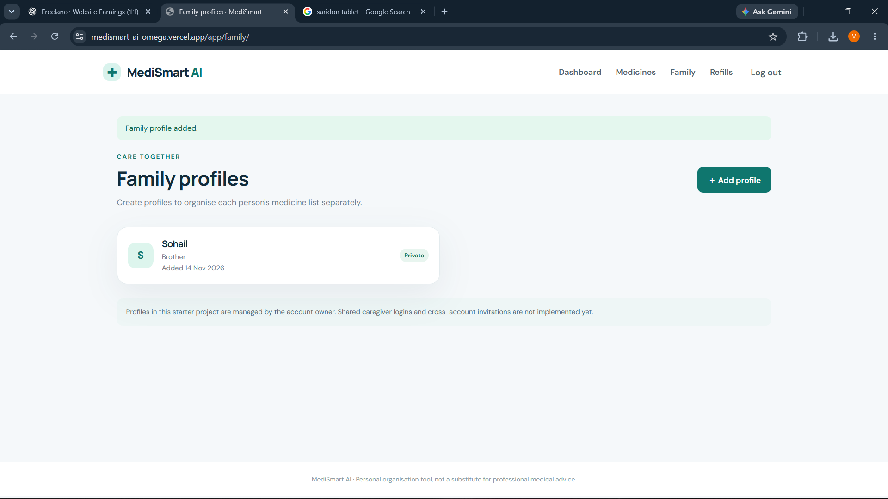
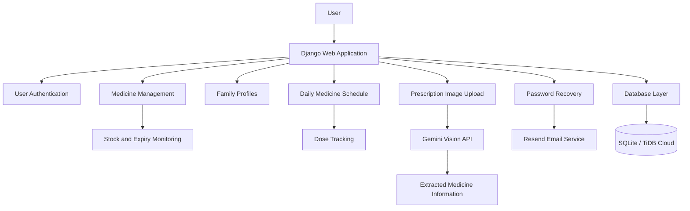

# 💊 MediSmart AI — Medicine Reminder & Management

A Django-based medicine management application designed to help users organize medicine schedules, monitor medicine stock, manage family profiles, and scan prescription images using Gemini Vision AI.

<p align="center">


</p>

<p align="center">

[📂 GitHub Repository](https://github.com/ShaikhVaiz/medismart-ai)

</p>

---

## 📑 Table of Contents

- [Overview](#-overview)
- [Problem Statement](#-problem-statement)
- [Key Features](#-key-features)
- [Application Screenshots](#-application-screenshots)
- [Technology Stack](#-technology-stack)
- [System Architecture](#-system-architecture)
- [Application Workflow](#-application-workflow)
- [Project Structure](#-project-structure)
- [Installation and Setup](#-installation-and-setup)
- [Environment Configuration](#-environment-configuration)
- [Database Configuration](#-database-configuration)
- [Running the Application](#-running-the-application)
- [Deployment](#-deployment)
- [Limitations](#-limitations)
- [Security and Medical Disclaimer](#-security-and-medical-disclaimer)
- [Future Improvements](#-future-improvements)
- [Author](#-author)

---

## 📌 Overview

**MediSmart AI** is a web-based medicine reminder and management application built with Django.

It provides a centralized place for users to manage their medicines, organize daily schedules, record taken or skipped doses, monitor stock levels, and maintain family profiles.

The application also includes a Gemini-powered prescription scanner that can extract medicine information from uploaded prescription or medicine images.

The project uses SQLite for local development and supports TiDB Cloud for a remote database configuration.

## 🎯 Problem Statement

Managing medicines and daily schedules can become difficult when information is scattered across prescriptions, medicine packages, and manual notes.

Users may need to:

- Keep track of multiple medicines.
- Remember daily medication schedules.
- Monitor remaining medicine quantities.
- Check medicine expiry dates.
- Organize medicine information for family members.
- Keep prescription information accessible.

MediSmart AI aims to make these activities easier through one digital medicine-management platform.

## ✨ Key Features

| Feature | Description |
|---|---|
| User Authentication | Signup, login, and logout using Django authentication |
| Medicine Management | Add, edit, and delete medicine records |
| Prescription Scanner | Uses Gemini Vision to extract medicine information from uploaded images |
| Daily Schedule Dashboard | Displays medicine schedules for the day |
| Dose Tracking | Records medicines as taken or skipped |
| Stock Management | Updates stock when a dose is marked as taken |
| Stock Monitoring | Estimates remaining stock days and displays low-stock warnings |
| Expiry Alerts | Identifies medicines with expired dates |
| Family Profiles | Organizes medicine records under family profiles |
| Refill Requests | Saves local medicine refill requests |
| Pharmacy Directory | Allows administrators to manage pharmacy directory entries |
| Password Recovery | Uses email OTP verification through Resend |
| Browser Notifications | Demonstrates foreground reminders while the dashboard remains open |

## 📸 Application Screenshots

### 1. Login Page


### 2. Dashboard



### 3. Prescription Scanner



### 4. Medicine Management



### 5. Family Profiles



---

## 🛠️ Technology Stack

| Component | Technology |
|---|---|
| Programming Language | Python |
| Backend Framework | Django |
| Frontend | HTML, CSS, JavaScript |
| AI Integration | Google Gemini API |
| Image Processing | Pillow |
| Database | SQLite / TiDB Cloud |
| Database Driver | PyMySQL |
| Email Service | Resend |
| Static File Handling | WhiteNoise |
| Environment Configuration | python-dotenv |
| Deployment Configuration | Vercel |

## 🏗️ System Architecture



## ⚙️ Application Workflow

1. The user creates an account or logs in.
2. The user accesses the medicine dashboard.
3. The user adds medicine details manually or uses the prescription scanner.
4. Medicine information and schedule times are saved.
5. The dashboard displays daily medicine schedules.
6. The user records doses as taken or skipped.
7. The application updates stock when a dose is marked as taken.
8. Stock and expiry warnings help users monitor their medicine records.
9. Family profiles allow users to organize medicines for family members.
10. Refill requests can be created and reviewed within the application.

## 📁 Project Structure

```text
medismart-ai/
│
├── docs/
│   └── screenshots/
│       ├── login.png
│       ├── dashboard.png
│       ├── prescription-scanner.png
│       ├── medicine-management.png
│       └── family-profiles.png
│
├── medismart/
│   ├── settings.py
│   ├── urls.py
│   ├── wsgi.py
│   └── asgi.py
│
├── tracker/
│   ├── migrations/
│   ├── models.py
│   ├── views.py
│   ├── forms.py
│   ├── urls.py
│   ├── emails.py
│   └── ai_scanner.py
│
├── templates/
├── static/
├── staticfiles/
│
├── .env.example
├── .gitignore
├── manage.py
├── requirements.txt
├── build_files.sh
└── vercel.json
```

## 🚀 Installation and Setup

### Prerequisites

- Python 3.10 or later
- Git
- Google Gemini API key for live prescription scanning
- Resend API key for email-based OTP delivery
- TiDB Cloud credentials for cloud database configuration

### 1. Clone the Repository

```bash
git clone https://github.com/ShaikhVaiz/medismart-ai.git
cd medismart-ai
```

### 2. Create a Virtual Environment

```powershell
py -m venv .venv
```

### 3. Activate the Virtual Environment

**Windows PowerShell:**

```powershell
.\.venv\Scripts\Activate.ps1
```

### 4. Install Dependencies

```powershell
python -m pip install --upgrade pip
pip install -r requirements.txt
```

### 5. Apply Database Migrations

```powershell
python manage.py makemigrations tracker
python manage.py migrate
```

### 6. Create an Administrator Account

```powershell
python manage.py createsuperuser
```

## 🔐 Environment Configuration

Create a `.env` file in the project root using the provided example:

```powershell
Copy-Item .env.example .env
```

Configure the values in `.env`:

```env
DEBUG=True
SECRET_KEY=your_secure_secret_key
ALLOWED_HOSTS=127.0.0.1,localhost

GEMINI_API_KEY=your_gemini_api_key

RESEND_API_KEY=your_resend_api_key
RESEND_FROM_EMAIL=your_verified_sender_email

USE_TIDB=False
TIDB_HOST=your_tidb_host
TIDB_PORT=4000
TIDB_USER=your_tidb_username
TIDB_PASSWORD=your_tidb_password
TIDB_DB_NAME=your_database_name
```

**Important:**

- Use a private, randomly generated `SECRET_KEY`.
- Never commit your real `.env` file or API credentials.
- Keep `USE_TIDB=False` for local SQLite development.
- Configure the required cloud database values before enabling TiDB.

## 🗄️ Database Configuration

MediSmart AI supports two database configurations:

| Database | Purpose |
|---|---|
| SQLite | Local development |
| TiDB Cloud | Remote MySQL-compatible database |

To use SQLite:

```env
USE_TIDB=False
```

To use TiDB Cloud:

```env
USE_TIDB=True
```

Configure the TiDB host, port, username, password, and database name before starting the application.

## ▶️ Running the Application

Start the Django development server:

```powershell
python manage.py runserver
```

Open your browser:

```text
http://127.0.0.1:8000/
```

### Administrator Panel

Visit:

```text
http://127.0.0.1:8000/admin/
```

Log in using the superuser account created during setup. The administrator can manage pharmacy directory entries.

## ☁️ Deployment

The repository includes a Vercel deployment configuration using Django's WSGI application.

For deployment:

1. Configure the required environment variables in the hosting platform.
2. Configure TiDB Cloud for persistent production database storage.
3. Set `DEBUG=False`.
4. Configure the appropriate `ALLOWED_HOSTS`.
5. Deploy the application using the repository's Vercel configuration.

**Important:** Local SQLite storage and temporary serverless storage should not be treated as persistent production storage.

## ⚠️ Limitations

- Browser reminders are a demonstration and are not guaranteed when the browser or device is closed.
- Refill requests are saved inside the application and are not sent to a real pharmacy.
- There is no online medicine catalogue, payment, or delivery integration.
- Prescription scanning may return incorrect or incomplete information.
- When Gemini credentials are unavailable or the API fails, the scanner can return demonstration or fallback data.
- Stock is reduced by one unit for each dose marked as taken. This may not represent every prescription's actual quantity.
- Family profiles belong to the account owner; caregiver invitations and shared access are not implemented.

## 🔒 Security and Medical Disclaimer

- Keep secret keys and API credentials private.
- Use HTTPS and production security settings when deploying.
- Do not enter real patient information into an unreviewed demonstration deployment.
- Always compare AI-extracted information with the original prescription.
- Confirm medicine names, strengths, and instructions with a qualified healthcare professional.
- MediSmart AI is a medicine-management project, not a substitute for medical advice, diagnosis, or treatment.

## 🚀 Future Improvements

- Improve dose quantity and stock reconciliation.
- Add reliable background and push notifications.
- Introduce caregiver invitations and permission management.
- Integrate pharmacy APIs and order-status tracking.
- Improve prescription scanning with manual verification.
- Add more automated tests.
- Improve production monitoring, backups, and security.

## 👨‍💻 Author

**Shaikh Vaiz**

- GitHub: [@ShaikhVaiz](https://github.com/ShaikhVaiz)
- Repository: [MediSmart AI](https://github.com/ShaikhVaiz/medismart-ai)

---

<p align="center">

**Built with Python, Django, Gemini Vision, and TiDB Cloud.**

</p>
