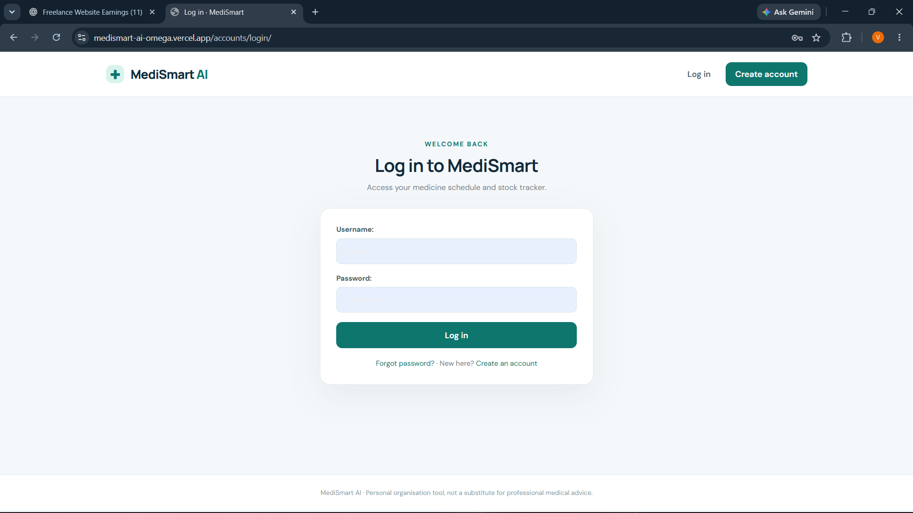

# MediSmart AI 💊

**An AI-powered medicine management platform designed to help users organize prescriptions, track medicines, and manage medication schedules.**

MediSmart AI combines Django, Gemini Vision, TiDB Cloud and Resend to provide a centralized platform for medicine management.

## ✨ Features

- **AI Prescription Scanning:** Use Gemini Vision to process prescription images.
- **Medicine Management:** Organize and manage medicine information.
- **Medicine Reminders:** Get browser-based reminders for medication schedules.
- **Stock Tracking:** Keep track of available medicine quantities.
- **Family Profiles:** Manage medicine information for family members.
- **Refill Management:** Manage medicine refill requests.
- **Email OTP Verification:** Secure email-based verification using Resend.
- **Cloud Database:** Store application data using TiDB Cloud.

## 🛠️ Technology Stack

| Technology | Purpose |
|---|---|
| Python | Backend programming |
| Django | Web framework |
| HTML, CSS, JavaScript | Frontend |
| Gemini Vision | AI prescription image processing |
| TiDB Cloud | Database |
| Resend | Email OTP delivery |
| Vercel | Deployment |

## 📸 Application Screenshots

### Login Page


### Dashboard


### AI Prescription Scanner


### Medicine Management


### Family Profiles


## 📁 Project Structure

```text
medismart-ai/
│
├── medismart/
├── tracker/
├── templates/
├── static/
├── staticfiles/
│
├── .env.example
├── .gitignore
├── manage.py
├── requirements.txt
├── build_files.sh
├── vercel.json
└── README.md
```

## 🚀 Local Installation

### 1. Clone the repository

```bash
git clone https://github.com/ShaikhVaiz/medismart-ai.git
cd medismart-ai
```

### 2. Create a virtual environment

```bash
python -m venv venv
```

Activate it on Windows:

```powershell
venv\Scripts\Activate.ps1
```

### 3. Install dependencies

```bash
pip install -r requirements.txt
```

### 4. Configure environment variables

Configure the required environment variables in your local environment or deployment platform, using `.env.example` as a reference.

Configure the following services:

- **Django:** `DEBUG`, `SECRET_KEY`, `ALLOWED_HOSTS`
- **Resend:** `RESEND_API_KEY`, `RESEND_FROM_EMAIL`
- **TiDB Cloud:** `USE_TIDB`, `TIDB_HOST`, `TIDB_PORT`, `TIDB_USER`, `TIDB_PASSWORD`, `TIDB_DB_NAME`
- **Gemini Vision:** `GEMINI_API_KEY`

For local development, `USE_TIDB=False` uses SQLite automatically.

Set `USE_TIDB=True` and provide your TiDB credentials to use the cloud database.

Never commit your actual `.env` file or expose API keys and passwords.

### 5. Apply database migrations

```bash
python manage.py migrate
```

### 6. Start the development server

```bash
python manage.py runserver
```

Open:

```text
http://127.0.0.1:8000/
```

## 🔐 Security

- Keep API keys and database credentials in environment variables.
- Do not upload `.env` files containing secrets.
- Use email OTP verification for account security.

## ⚕️ Disclaimer

MediSmart AI is a medicine management and organization tool. It is not a substitute for professional medical advice, diagnosis or treatment. Always follow instructions from a qualified healthcare professional.

## 👨‍💻 Developer

**Shaikh Vaiz**

GitHub: [ShaikhVaiz](https://github.com/ShaikhVaiz)

---

*Built with Python, Django and AI-powered technology.*
